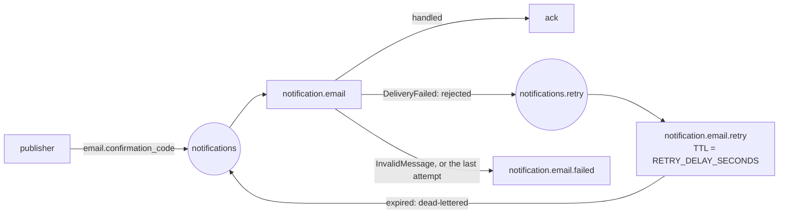

# Architecture

## Layers

The same clean architecture as the identity service:

```
domain  <-  application  <-  infrastructure, presentation  <-  bootstrap, main
```

| Layer | Folder | What it holds |
|---|---|---|
| Domain | `app/domain` | value objects that check themselves (`Email`, `ConfirmationCode`, `CodePurpose`), the `EmailMessage` entity, `DomainError`s |
| Application | `app/application` | the use case (`SendConfirmationCode`), its DTOs, its ports (`EmailSender`, `EmailRenderer`, `Clock`), and its errors: `DeliveryFailed` (try again later) and `InvalidMessage` (set aside) |
| Infrastructure | `app/infrastructure` | RabbitMQ (`rabbitmq/topology.py`, `rabbitmq/consumer.py`), the senders (`email/console.py`, `email/smtp.py`), the templates and their renderer, the clock, the settings |
| Presentation | `app/presentation` | `messaging/`: the message contract (pydantic) and the handler that turns a message into a use case's input. `api/`: the health route |
| Composition | `app/bootstrap/container.py`, `app/main.py` | builds everything; the app's lifespan starts the consumer |

The consumer, in infrastructure, knows nothing about the messages. It gives
each one to a handler (routing key, body, id) and reacts to the application's
errors. The handler, in presentation, knows the messages but nothing about
RabbitMQ. `tests/test_architecture.py` enforces the import rules.

## Queues

`app/infrastructure/rabbitmq/topology.py`, declared at start:



- **A delivery that fails for now** (`DeliveryFailed`, or an unexpected error)
  is rejected. RabbitMQ moves it to the retry queue, where it waits
  `RETRY_DELAY_SECONDS`, then sends it back with its routing key. RabbitMQ
  counts the rejections in the `x-death` header, and the consumer reads that
  count. On the `MAX_ATTEMPTS`-th failure it moves the message to the failed
  queue instead.
- **A message that can never work** (`InvalidMessage`: bad JSON, an unknown
  type or version, an address the mail server refuses for good) goes to the
  failed queue at once.
- **Moving a message aside** publishes it to `notification.email.failed` and
  then acknowledges the original. It carries `x-failure-reason` and
  `x-original-routing-key`, and its body is unchanged.

`RABBITMQ_PREFETCH` bounds how many messages are in flight. SMTP runs in a
worker thread, so several emails go out in parallel.

## Decisions

**Messages, not HTTP.** The identity service doesn't wait for SMTP and doesn't
fail when the mail server is slow. A confirmed publish is durable, so codes
survive this service restarting. The cost is that email is asynchronous: the
API can't say "sent", only "on its way".

**Events say what, this service says how.** The identity service sends the
code and its purpose, not an email. The words, the HTML and the subject live
here, and other kinds of notification can be added without touching the
publishers.

**At least once.** A crash between sending and acknowledging sends the email
again. For a code, that's harmless. A notification that must not be
duplicated would need its `id` stored (a Redis set with a TTL), which isn't
needed yet.

**An expired code isn't sent.** After a long outage, a stale code would only
confuse. The email says how long the code still works, from `created_at`.

**Temporary or permanent.** SMTP 5xx refusals of the recipient are permanent
(`UndeliverableEmail`). Connection errors and 4xx answers are temporary.
Telling the two apart keeps the retry queue for problems that time can fix.

**The consumer doesn't block the API.** The lifespan starts the connection in
the background, and it retries until RabbitMQ answers. `/health` is 503 until
the service consumes, which is what Docker's health check and the compose
`depends_on` wait for.

**Health checks wait for RabbitMQ's cookie.** Running `rabbitmq-diagnostics`
in the container before the broker has created its Erlang cookie creates the
file with the wrong owner, and the broker stops. The checks (compose file, CI,
`make test-rabbitmq`) first test that `/var/lib/rabbitmq/.erlang.cookie`
exists.
